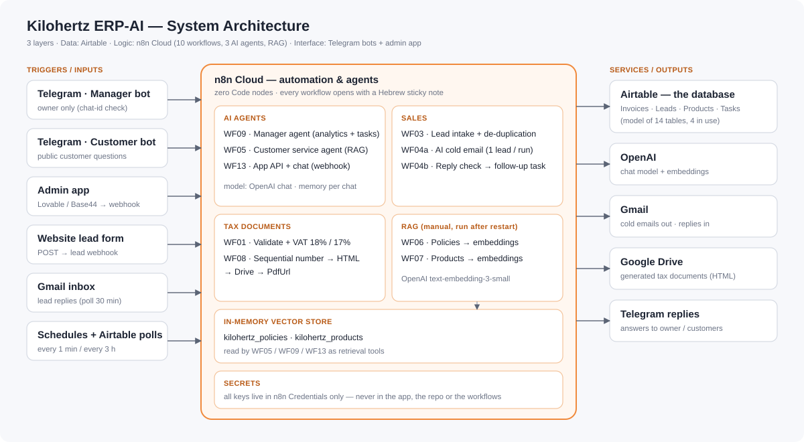
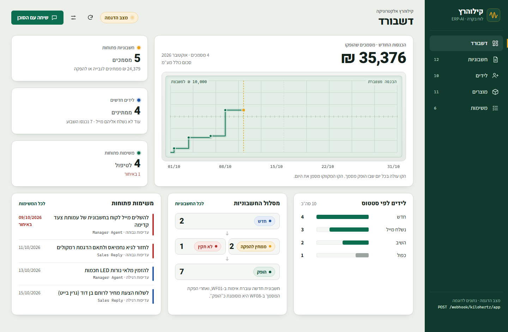
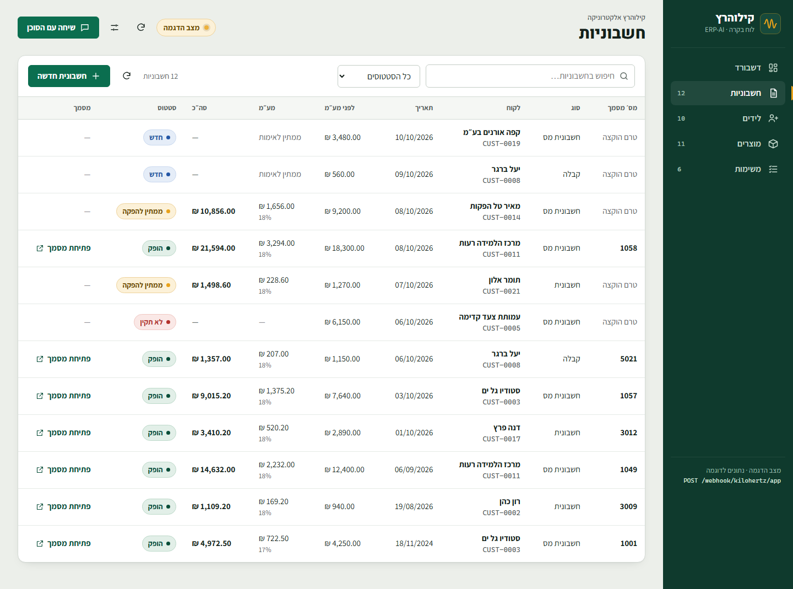
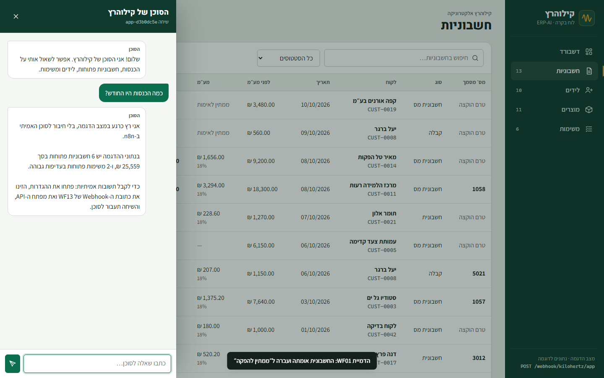

<div dir="rtl">

# Kilohertz ERP-AI · מערכת ניהול חכמה לעסק אלקטרוניקה

**פרויקט גמר · קורס מיישם AI (53500), ג'ון ברייס · דור ביניאשוילי**

מערכת ERP קטנה ל"קילוהרץ אלקטרוניקה", עסק אלקטרוניקה ישראלי בדיוני. המערכת בנויה מ-**n8n**, **שלושה סוכני AI**, **RAG** ו-**Airtable**, ועליה יושבת אפליקציית ניהול. הכול רץ בענן, בלי שרת ובלי קוד.



## מה יש בפרויקט
- **3 סוכני AI:**
  - **סוכן מנהל:** בוט טלגרם לבעלים בלבד. עונה על שאלות אנליטיקה, מחובר לשני מאגרי ה-RAG ופותח משימות.
  - **סוכן שירות לקוחות:** בוט טלגרם שני. עונה רק מתוך המדיניות והקטלוג, בעזרת RAG.
  - **סוכן מכירות:** שולח מיילים קרים עם שורת הסרה, ובודק תשובות. תשובה מעדכנת את הליד ופותחת משימת מעקב, ובקשת "הסר" מכובדת.
- **10 תהליכי n8n:** WF01, 03, 04a, 04b, 05, 06, 07, 08, 09 ו-13. כולם בלי צמתי Code, וכל אחד נפתח בפתק הסבר בעברית.
- **RAG** מעל 9 מסמכי מדיניות ו-30 מוצרים, עם Embeddings רב-לשוניים.
- **מסמכי מס ישראליים:**
  - מע"מ 18%, או 17% לפני 01/01/2025.
  - מספור רץ נפרד לכל סוג מסמך.
  - הבחנה בין חשבונית, חשבונית מס וקבלה.
  - מסמך HTML בעברית שנשמר ב-Google Drive.
- **אפליקציית ניהול** ב-Lovable או ב-Base44: דשבורד, טבלאות (כולל לקוחות והזמנות מהמודל המורחב), טפסים וצ'אט. היא מתחברת דרך Webhook אחד מאובטח, ומצורף גם לקוח ייחוס שעובד במצב הדגמה.
- **מסמך אפיון PRD/SOW** מלא, ו-**סכימה** של 14 טבלאות. 4 מהן בשימוש.

## שלוש השכבות
| שכבה | כלי | תפקיד |
|---|---|---|
| נתונים | Airtable | 4 טבלאות פעילות (Invoices, Leads, Products, Tasks) מתוך מודל של 14 |
| לוגיקה | n8n Cloud | 10 תהליכים, 3 סוכנים ומאגר וקטורי |
| ממשק | Telegram, Lovable / Base44 | שני בוטים ואפליקציית ניהול |

## התהליכים
| # | שם | טריגר | צילום |
|---|---|---|---|
| WF01 | אימות מסמכי מס וחישוב מע"מ | Airtable, כל דקה | [קנבס](docs/screenshots/wf01-canvas.png) |
| WF03 | קליטת לידים וסינון כפילויות | Webhook | [קנבס](docs/screenshots/wf03-canvas.png) |
| WF04a | סוכן מכירות: מייל קר | כל 3 שעות | [קנבס](docs/screenshots/wf04a-canvas.png) |
| WF04b | סוכן מכירות: בדיקת תשובות | Gmail, כל 30 דקות | [קנבס](docs/screenshots/wf04b-canvas.png) |
| WF05 | סוכן שירות לקוחות (RAG) | בוט טלגרם #2 | [קנבס](docs/screenshots/wf05-canvas.png) |
| WF06 | מדיניות → מאגר וקטורי | ידני | [קנבס](docs/screenshots/wf06-canvas.png) |
| WF07 | מוצרים → מאגר וקטורי | ידני | [קנבס](docs/screenshots/wf07-canvas.png) |
| WF08 | הפקת מסמך והעלאה ל-Drive | כל דקה | [קנבס](docs/screenshots/wf08-canvas.png) |
| WF09 | סוכן המנהל | בוט טלגרם #1 | [קנבס](docs/screenshots/wf09-canvas.png) |
| WF13 | ה-API של האפליקציה | Webhook | [קנבס](docs/screenshots/wf13-canvas.png) |

פירוט מלא של כל תהליך, צומת אחר צומת: [docs/03-workflows.md](docs/03-workflows.md)


## אפליקציית הניהול


| | |
|---|---|
|  |  |

- **[app/build-prompt.md](app/build-prompt.md):** פרומפט הבנייה ל-Lovable או ל-Base44, פרומפטים לשיפורים וצ'קליסט קבלה.
- **[app/index.html](app/index.html):** לקוח ייחוס שעובד מול WF13 ומכסה את 4 טבלאות הליבה. בלי הגדרות הוא נפתח ב**מצב הדגמה** עם נתונים בדיוניים.
- **[docs/05-app.md](docs/05-app.md):** מודל החיבור והאבטחה.

## מבנה הריפו
```
workflows/        10 תהליכי n8n, מוכנים לייבוא
data/schema.json  מקור האמת למודל הנתונים (14 טבלאות, 4 בשימוש)
data/policies/    9 מסמכי מדיניות (המקור לצומת "מסמך המדיניות" ב-WF06)
data/products.csv קטלוג 30 מוצרים לייבוא ל-Airtable
templates/        תבנית מסמך המס (HTML, RTL), שמוטמעת ב-WF08
app/              פרומפט הבנייה ולקוח הייחוס
docs/             אפיון, מדריך הקמה, תהליכים, בדיקות, אפליקציה, מילון מונחים, צילומים
```

## הקמה מהירה
1. פותחים חשבונות: n8n Cloud, Airtable, OpenAI, שני בוטים מ-BotFather ו-Google.
2. מגדירים 7 Credentials ב-n8n. השמות מופיעים במדריך.
3. בונים את 4 הטבלאות לפי `data/schema.json` ומייבאים את `data/products.csv`.
4. מייבאים את 10 התהליכים, בוחרים בסיס, טבלה ו-Credential, ומזינים את ה-Chat ID של הבעלים ב-WF09.
5. מריצים את WF06 ואז את WF07, ומפעילים את השאר.
6. בונים את האפליקציה מהפרומפט ומחברים אותה ל-WF13.

המדריך המלא: [docs/02-setup-guide.md](docs/02-setup-guide.md) · הבדיקות: [docs/04-testing.md](docs/04-testing.md) · האפיון: [docs/01-specification.md](docs/01-specification.md) · מילון מונחים: [docs/06-glossary.md](docs/06-glossary.md)

## החלטות תכנון
- **הסוכן מנסח והצמתים מחשבים.** סוכן המנהל מקבל מספרים שחושבו מראש ב-Summarize, ולכן אין לו מה להמציא.
- **בדיקת הרשאה לפני המודל.** משתמש זר לא מגיע לסוכן ולא צורך טוקנים.
- **כתיבה רגישה רק באישור.** הסוכן פותח משימה רק אחרי אישור מפורש של הבעלים.
- **נקודת כניסה אחת לאפליקציה.** כל הקריאות והכתיבות עוברות דרך WF13: מפתח בכותרת, רשימת טבלאות מורשות ותשובת שגיאה אחידה. מפתחות Airtable לא מגיעים לדפדפן.
- **שליחה זהירה.** WF04a שולח מייל אחד בכל הרצה, כך שטעות לא תשלח עשרות מיילים.
- **הגנה מפני הזרקה לנוסחאות Airtable.** אימייל עם מירכאות נדחה בכניסה, גם ב-WF03 וגם ב-WF13.
- **אין כפילויות בלידים.** אותה בדיקה רצה גם כשליד נכנס מהאתר (WF03) וגם כשהוא נכנס מהאפליקציה (WF13).

## מגבלות ידועות (בכוונה, לשם פשטות)
- המאגר הווקטורי וזיכרון הסוכנים יושבים בזיכרון ונמחקים בכל הפעלה מחדש של n8n. אחרי הפעלה מחדש מריצים שוב את WF06 ואת WF07.
- המסמך נשמר כ-HTML ב-Drive. כדי לקבל PDF: Open with Google Docs ואז File → Download → PDF.
- טריגרים של Airtable סורקים כל דקה, ומספור רץ עלול להתנגש אם שני מסמכים נוצרים באותה דקה.
- Google OAuth במצב Testing: הטוקן פג אחרי 7 ימים.
- WF08 רץ כל דקה, כמו שהמשימה מגדירה. בסביבת ייצור מומלץ כל 10 דקות.
- אין ניסיונות חוזרים. שגיאות נראות ב-Executions. החריג הוא WF13, שתמיד מחזיר תשובה לאפליקציה.
- WF13 `create` כותב את ה-payload כמו שהוא, ולכן שמות המפתחות חייבים להיות זהים לשמות העמודות.
- האפליקציה מיועדת למשתמש אחד, ומכסת ה-API של Airtable היא כ-5 בקשות לשנייה.

## אבטחה
- אין בריפו סודות. כל המפתחות נשמרים ב-Credentials של n8n וב-Secrets של האפליקציה.
- מזהי ה-Credentials בקבצים הם הפניות לשם בלבד, ואחרי הייבוא בוחרים מחדש את החיבורים שלכם.
- הדומיין `kilohertz.example` והפרטים העסקיים בדיוניים.

</div>

---

## English summary

**Kilohertz ERP-AI** is a final project for John Bryce's AI course (53500). It is a small, no-code ERP for a fictional Israeli electronics retailer. The data layer is **Airtable**. The automation layer is **n8n Cloud**, with 10 workflows, 3 AI agents and RAG. The interface is two **Telegram** bots plus an admin app built with **Lovable / Base44**, which talks to n8n through a single authenticated webhook.

- **Agents.** Owner-only manager agent: analytics are pre-computed with Summarize, and tools can search tasks, create a task after confirmation, and search both RAG stores. Customer-service agent grounded in policy and product vector stores. Sales agent that sends one cold email per run and detects replies.
- **Israeli tax rules.** 18% VAT (17% before 2025-01-01), per-type sequential numbering, and Hebrew RTL documents uploaded to Google Drive.
- **Zero Code nodes.** All logic is in Edit Fields, IF, Switch, Summarize and Convert to File.
- **Verification.** Every workflow imports cleanly into n8n 2.19.5. Core logic was executed against mock data, and the webhook's auth and error paths were tested with curl. See `docs/04-testing.md`.

Built by **Dor Biniashvili** as an original implementation of the course specification.
