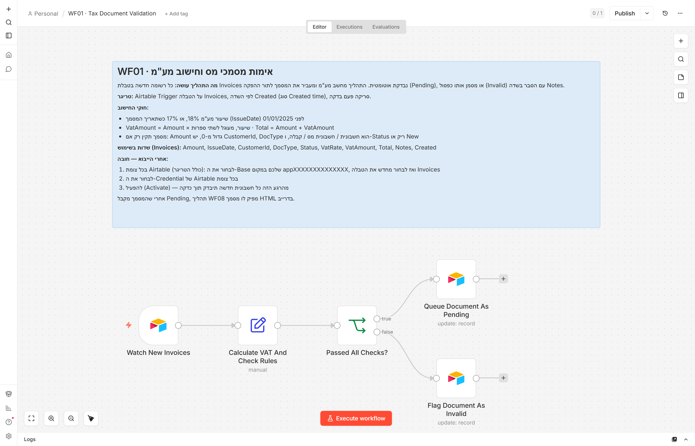
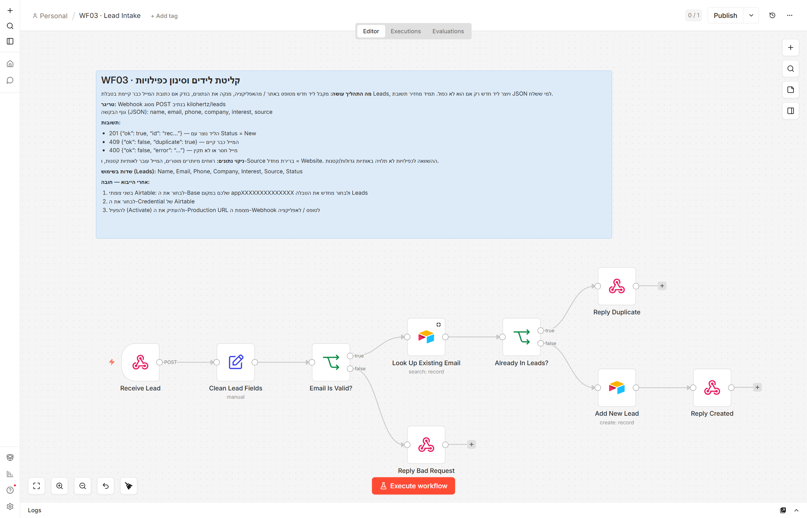
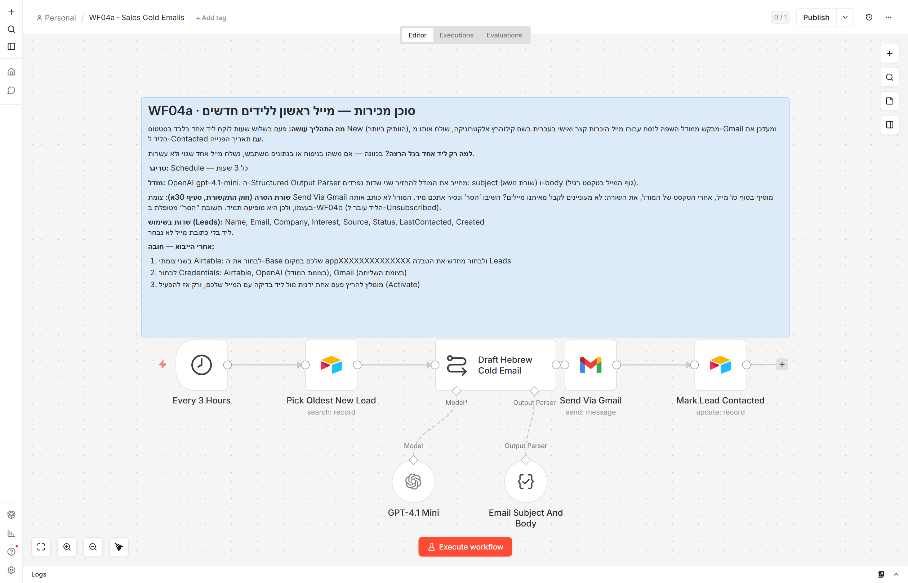
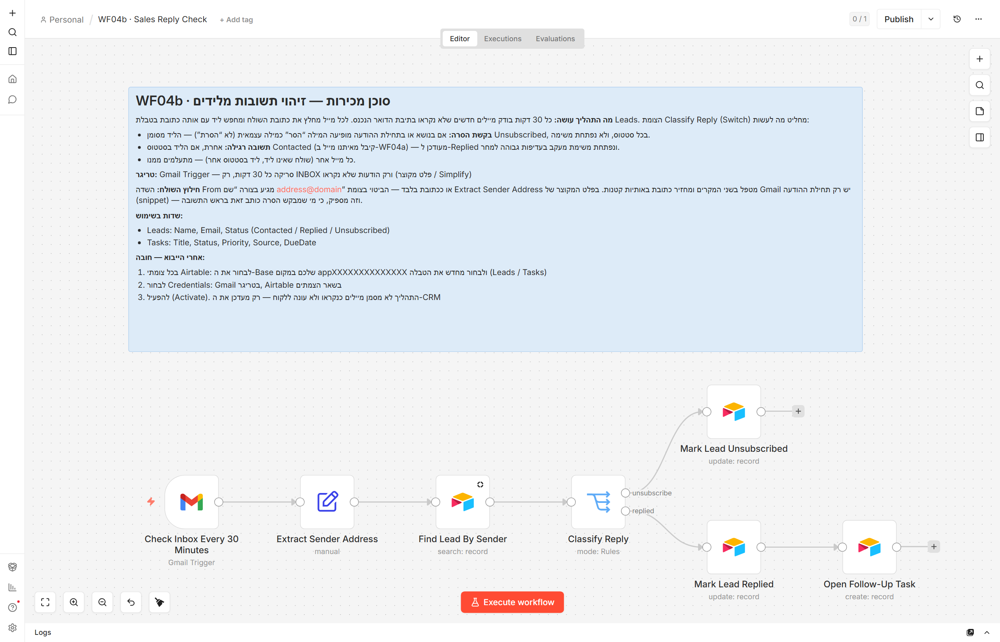
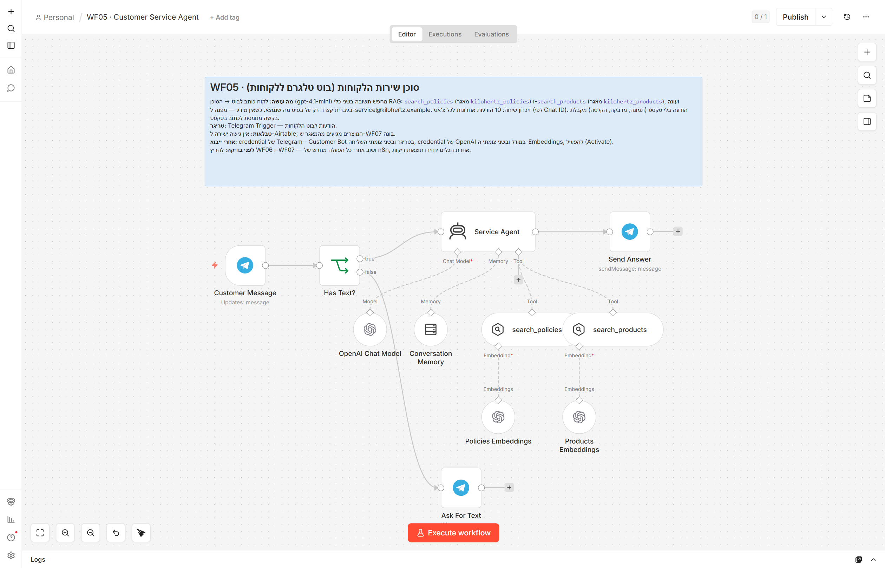
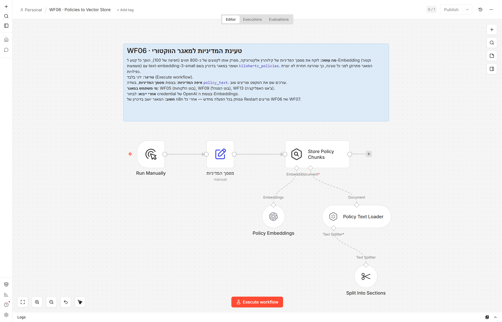
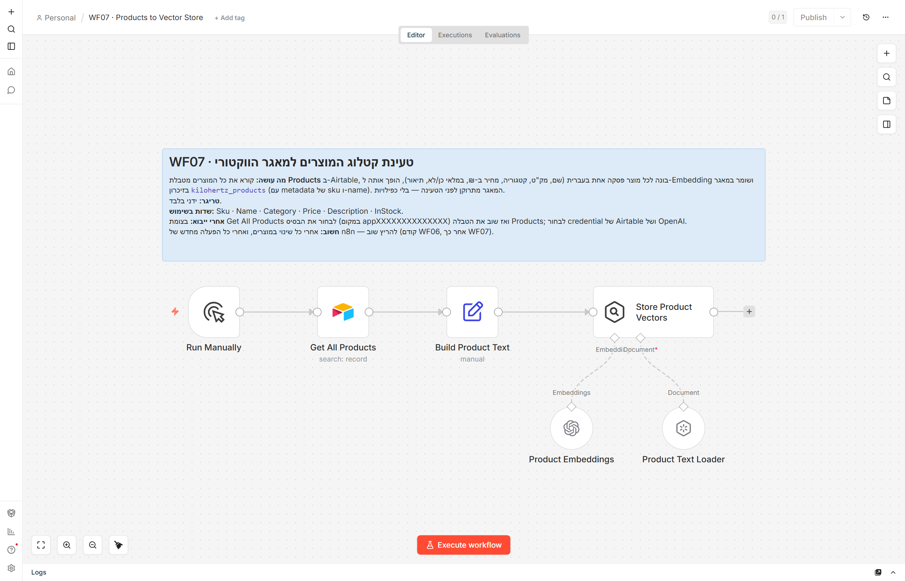
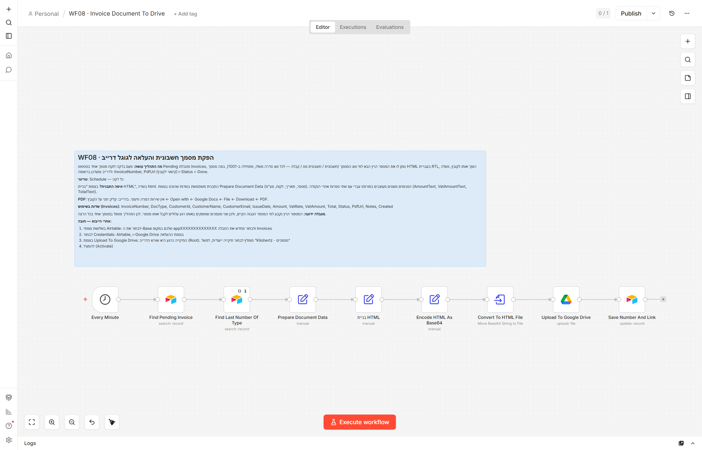
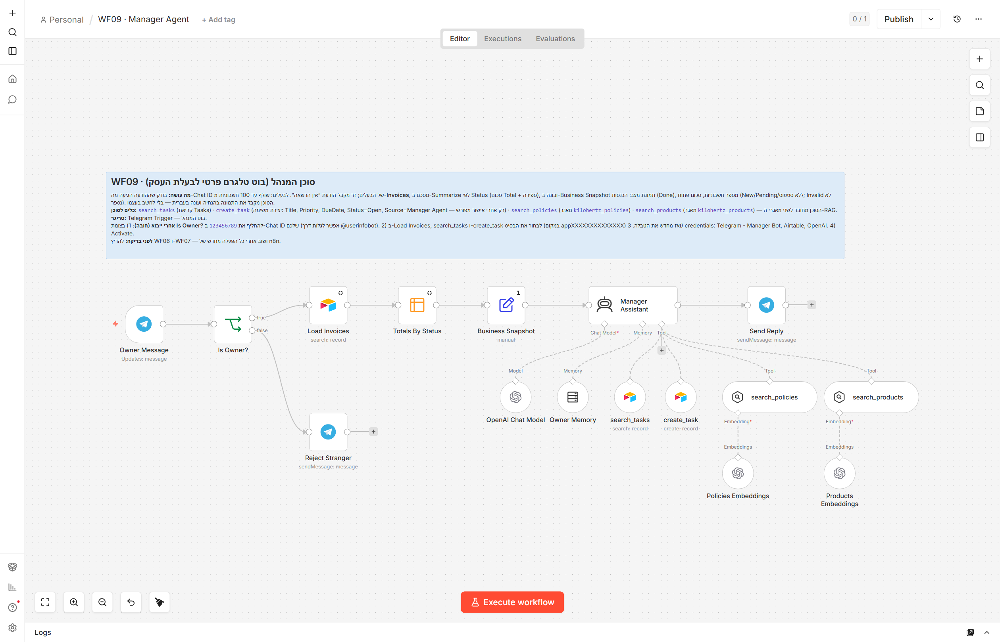
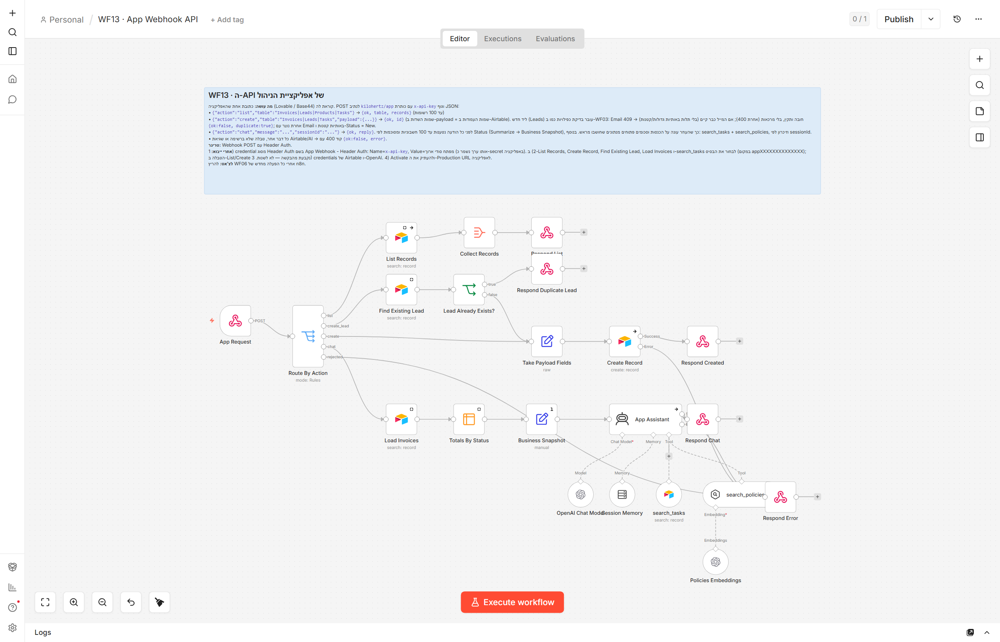

# 03 · עשרת התהליכים (Workflows)

כל קובץ בתיקייה `workflows/` הוא תהליך n8n שמוכן לייבוא. כל תהליך נפתח בפתק (Sticky Note) בעברית. הפתק מסביר מה התהליך עושה, מה מפעיל אותו, באילו שדות הוא משתמש ומה חובה לעשות אחרי הייבוא.

**עקרונות משותפים**
- **אפס צמתי Code.** חישובים נעשים ב-Edit Fields, החלטות ב-IF ו-Switch, סיכומים ב-Summarize, והפקת קבצים ב-Convert to File.
- **מוחות:** OpenAI. מודל הצ'אט הוא `gpt-4.1-mini`, ומודל ה-Embeddings הוא `text-embedding-3-small`, שהוא רב-לשוני ותומך היטב בעברית.
- **מאגר וקטורי בזיכרון:** `kilohertz_policies` למדיניות ו-`kilohertz_products` למוצרים.
- **מספור לפי מסמך המשימה:** המספרים 2, 10, 11 ו-12 חסרים בכוונה.
- **מבנה הפלט של Airtable:** צומת Airtable (גרסה 2.2) וגם הטריגר מחזירים רשומה במבנה `{id, createdTime, fields:{…}}`. לכן כל הביטויים קוראים `$json.fields.X`.

| # | קובץ | מה עושה | טריגר | טבלאות |
|---|---|---|---|---|
| WF01 | `wf01-tax-document-validation.json` | אימות מסמך מס חדש, חישוב מע"מ (18%, או 17% לפני 01/01/2025), והעברה ל-`Pending` או `Invalid` עם הסבר | Airtable Trigger על השדה `Created`, כל דקה | Invoices |
| WF03 | `wf03-lead-intake.json` | קליטת ליד, ניקוי נתונים וסינון כפילויות לפי אימייל. מחזיר 201, 409 או 400 | Webhook POST `kilohertz/leads` | Leads |
| WF04a | `wf04a-sales-cold-emails.json` | בחירת ליד אחד בסטטוס `New`, כתיבת מייל אישי בעברית עם AI, שליחה ב-Gmail ועדכון ל-`Contacted` | Schedule כל 3 שעות | Leads |
| WF04b | `wf04b-sales-reply-check.json` | זיהוי תשובה מליד: עדכון ל-`Replied` ופתיחת משימת מעקב. אם הליד ביקש "הסר", עדכון ל-`Unsubscribed` | Gmail Trigger כל 30 דקות | Leads, Tasks |
| WF05 | `wf05-customer-service-agent.json` | סוכן שירות לקוחות שעונה רק מתוך המדיניות והקטלוג (RAG), עם זיכרון לכל צ'אט | בוט טלגרם #2 (לקוחות) | מאגר וקטורי |
| WF06 | `wf06-policies-to-vector-store.json` | טעינת מסמך המדיניות מהצומת "מסמך המדיניות" אל המאגר הווקטורי | ידני | מאגר וקטורי |
| WF07 | `wf07-products-to-vector-store.json` | טעינת קטלוג המוצרים מ-Airtable אל המאגר הווקטורי | ידני | Products |
| WF08 | `wf08-invoice-document-to-drive.json` | מספור רץ לפי סוג מסמך, בניית HTML בעברית בצומת "בניית HTML", העלאה ל-Drive ושמירת קישור ב-`PdfUrl` | Schedule כל דקה | Invoices |
| WF09 | `wf09-manager-agent.json` | סוכן מנהל לבעלים בלבד. מקבל תמונת מצב שחושבה מראש, ויש לו כלים לחיפוש משימות, יצירת משימה (באישור), מדיניות ומוצרים | בוט טלגרם #1 (מנהל) | Invoices, Tasks |
| WF13 | `wf13-app-webhook-api.json` | API אחד לאפליקציה: `list`, `create` ו-`chat`, עם Header Auth ורשימת טבלאות מורשות | Webhook POST `kilohertz/app` | כל 4 הטבלאות |

---

## WF01 · אימות מסמכי מס
`Watch New Invoices → Calculate VAT And Check Rules → Passed All Checks? → Queue Document As Pending / Flag Document As Invalid`

- **מע"מ:** שיעור המע"מ נקבע לפי `IssueDate`. `VatAmount` מעוגל ל-2 ספרות, ו-`Total = Amount + VatAmount`. השדה `VatRate` נשמר כשבר עשרוני, למשל 0.18.
- **בדיקות:** הסכום חיובי, יש `CustomerId`, הערך של `DocType` הוא אחד משלושת הסוגים, והסטטוס הוא `New` או ריק.
- **מסמך לא תקין:** הסיבה נכתבת בעברית לשדה `Notes`.
- **אחרי תיקון:** הטריגר מגיב רק לרשומות חדשות לפי השדה `Created`. לכן מתקנים את הנתונים ומזינים את המסמך מחדש כרשומה חדשה, למשל על ידי שכפול השורה.

## WF03 · קליטת לידים וסינון כפילויות
`Receive Lead → Clean Lead Fields → Email Is Valid? → Look Up Existing Email → Already In Leads? → Add New Lead → Reply Created`

- **ניקוי נתונים:** רווחים מיותרים נמחקים, האימייל מומר לאותיות קטנות, וערך ברירת המחדל של `Source` הוא `Website`.
- **כפילות:** נבדקת עם `LOWER({Email})`, כך שאותו אימייל באותיות שונות נחשב כפול.
- **הגנה מפני הזרקה:** אימייל עם מירכאות נדחה, כדי למנוע הזרקה לנוסחת Airtable.

## WF04a · סוכן מכירות: מייל קר
`Every 3 Hours → Pick Oldest New Lead → Draft Hebrew Cold Email → Send Via Gmail → Mark Lead Contacted`

- **ליד אחד בכל הרצה, בכוונה:** טעות לא תשלח עשרות מיילים.
- **ניסוח:** ה-AI מחזיר נושא וגוף מייל בפורמט מובנה, דרך Structured Output Parser.
- **שורת הסרה קבועה:** צומת Gmail מוסיף בסוף כל מייל את השורה "לא מעוניינים לקבל מאיתנו מיילים? השיבו 'הסר' ונסיר אתכם מיד." השורה נוספת שם ולא נכתבת על ידי המודל, כך שהיא מופיעה תמיד, כנדרש בחוק התקשורת (סעיף 30א).
- **הנחת הסכמה:** הלידים הם פונים שהשאירו פרטים בטופס באתר והסכימו לקבל הצעות. בלי הסכמה כזאת, החוק מחייב להוסיף את המילה "פרסומת" לנושא המייל.

## WF04b · סוכן מכירות: בדיקת תשובות
`Check Inbox Every 30 Minutes → Extract Sender Address → Find Lead By Sender → Classify Reply → Mark Lead Replied → Open Follow-Up Task` (או `Mark Lead Unsubscribed`)

- **חילוץ השולח:** כתובת האימייל נשלפת מהשדה `From` בעזרת ביטוי (Expression), בלי קוד. זה עובד גם בפורמט `שם <כתובת>` וגם עם כתובת בלבד.
- **Classify Reply:** צומת Switch עם שלוש תוצאות.
  - המילה "הסר" מופיעה כמילה עצמאית בנושא או בתקציר ההודעה → `Unsubscribed`, בלי משימה.
  - הליד בסטטוס `Contacted` → `Replied` ומשימת מעקב.
  - כל מקרה אחר → מתעלמים.
- **משימת מעקב:** מקבלת עדיפות `גבוהה` ותאריך יעד למחרת.

## WF05 · סוכן שירות לקוחות (RAG)
`Customer Message → Has Text? → Service Agent → Send Answer` (ואם ההודעה אינה טקסט: `Ask For Text`)

- **כלים:** `search_policies` למדיניות ו-`search_products` למוצרים, מחיר ומלאי.
- **הנחיות לסוכן:** לא להמציא, להפנות לנציג אנושי כשצריך, ולענות בקצרה כמתאים לטלגרם.

## WF06 · מדיניות → מאגר וקטורי
`Run Manually → מסמך המדיניות → Store Policy Chunks`

- **עריכת המדיניות:** הטקסט יושב בצומת "מסמך המדיניות". עורכים אותו שם ומריצים שוב.
- **מקור הטקסט:** חיבור של קבצי `data/policies/*.md`.
- **טעינה נקייה:** המאגר מתרוקן לפני כל טעינה, כך שאין כפילויות.

## WF07 · מוצרים → מאגר וקטורי
`Run Manually → Get All Products → Build Product Text → Store Product Vectors`

## WF08 · הפקת מסמך והעלאה לדרייב
`Every Minute → Find Pending Invoice → Find Last Number Of Type → Prepare Document Data → בניית HTML → Encode HTML As Base64 → Convert To HTML File → Upload To Google Drive → Save Number And Link`

- **מספור:** סדרה נפרדת לכל סוג מסמך, שמתחילה ב-1001.
- **תבנית:** `templates/invoice.html` מוטמעת בצומת "בניית HTML".
- **למה Base64:** צומת Convert to File שומר טקסט רגיל כ-`text/plain`. כדי שהקובץ יישמר כ-`text/html` ויוצג נכון ב-Drive, ה-HTML מקודד קודם ל-Base64 (בעזרת ביטוי).

## WF09 · סוכן המנהל
`Owner Message → Is Owner? → Load Invoices → Totals By Status → Business Snapshot → Manager Assistant → Send Reply`

- **בדיקת בעלים:** ה-Chat ID של הבעלים מוזן בתנאי של הצומת `Is Owner?`. מי שאינו הבעלים מקבל דחייה מנומסת, והמודל לא רץ בכלל.
- **חישוב מראש:** המספרים מחושבים לפני הסוכן, בעזרת Summarize ו-Edit Fields. הסוכן רק מנסח, ולכן לא ממציא נתונים.
- **כלים:** `search_tasks`, `create_task` (רק אחרי אישור מפורש של הבעלים), `search_policies` ו-`search_products`. הסוכן מחובר לשני מאגרי ה-RAG, ולכן צריך להריץ את WF06 ואת WF07 לפני השימוש.

## WF13 · ה-API של האפליקציה
`App Request → Route By Action → (list | create_lead | create | chat | rejected) → Respond …`

- **אימות:** Header Auth עם הכותרת `x-api-key`. המפתח נשמר רק ב-Credential של n8n ובצד השרת של האפליקציה.
- **create_lead:** ליד חדש מהאפליקציה עובר את אותה בדיקת כפילויות כמו ב-WF03.
  - אימייל קיים → 409 `{ok:false, duplicate:true}`.
  - אימייל לא תקין → 400.
  - אחרת נוצר ליד בסטטוס `New`.
- **chat:** לפני הסוכן מחושבת תמונת מצב של החשבוניות, כמו ב-WF09. כך העוזר עונה על שאלות הכנסות בלי לסכם רשומות בעצמו. יש לו גם `search_tasks` ו-`search_policies`.
- **בקשה לא מורשית:** טבלה שאינה ברשימה, פעולה לא מוכרת או צ'אט ריק מחזירים 400 עם `{ok:false, error}`.

